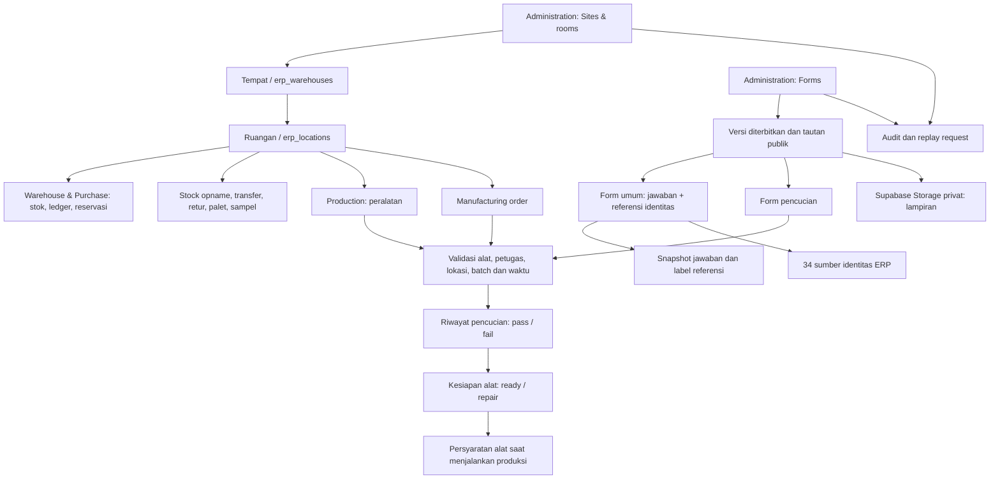
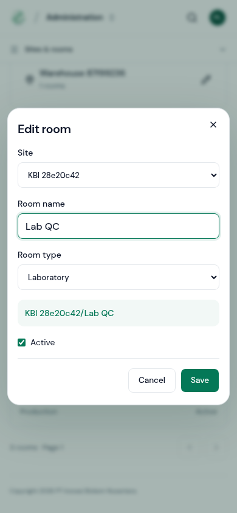
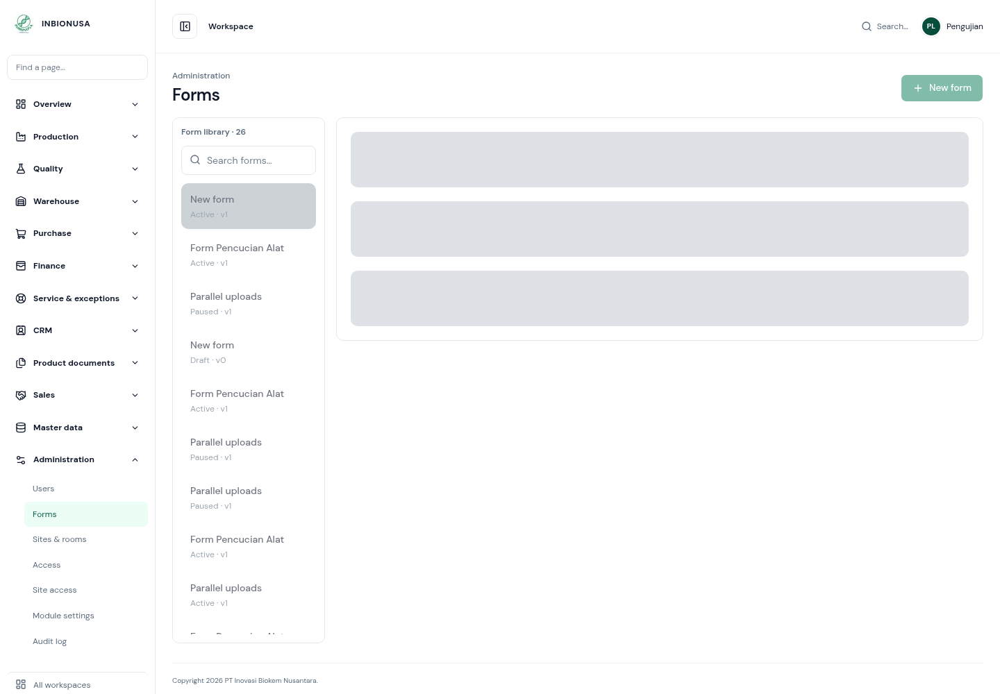
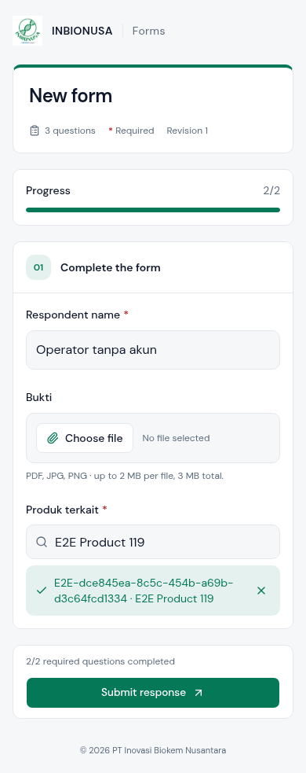
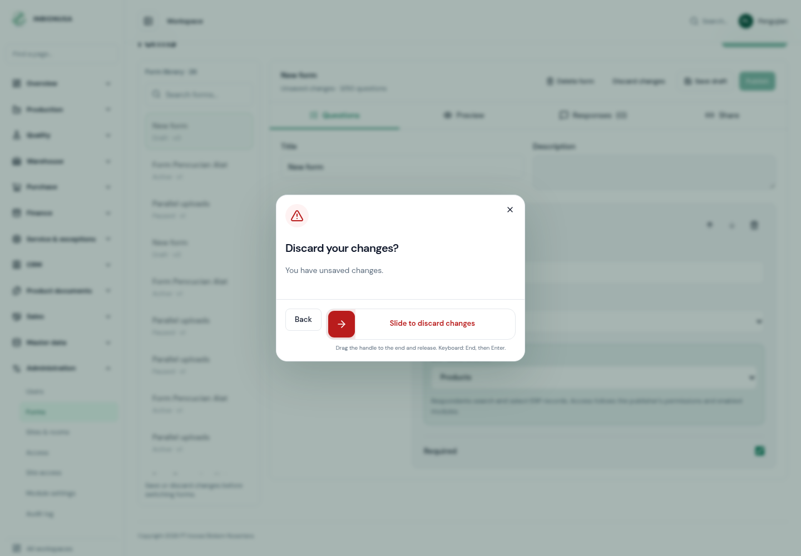

# Audit Forms, Sites & rooms — 28 Oktober 2026

Audit kode, aturan PostgreSQL, API, dan interaksi Chromium pada database lokal terisolasi. Data produksi tidak digunakan sebagai fixture. Hasil ini mencakup alur di bawah; bukan pernyataan bahwa seluruh ERP bebas bug.

## Temuan dan perbaikan

| Prioritas | Pemicu dan dampak sebelumnya                                                                                                                                          | Perbaikan                                                                                                                                                                                                                                             |
| --------- | --------------------------------------------------------------------------------------------------------------------------------------------------------------------- | ----------------------------------------------------------------------------------------------------------------------------------------------------------------------------------------------------------------------------------------------------- |
| Tinggi    | Produksi `completed` masih menunggu penutupan, tetapi ruangan dapat dinonaktifkan. Penutupan kemudian terhalang pemeriksaan lokasi aktif.                             | Status `completed` tetap mengunci penonaktifan sampai pesanan `closed` atau `cancelled`.                                                                                                                                                              |
| Tinggi    | Pembatasan penonaktifan hanya diperiksa pada command layar baru. Jalur penulisan lama bisa melewatinya.                                                               | Trigger pada tempat dan ruangan memeriksa aturan yang sama. Penguncian di tingkat statement dilakukan sebelum penguncian baris untuk menjaga urutan lock.                                                                                             |
| Tinggi    | Respons jaringan dapat hilang setelah transaksi jawaban berhasil. Penanganan kegagalan bisa menghapus lampiran yang sebenarnya sudah tersimpan.                       | Pengiriman diulang dengan identitas yang sama; database membedakan lampiran asli dan unggahan dari percobaan ulang. Hasil commit yang belum pasti tidak memicu penghapusan berkas.                                                                    |
| Sedang    | Form baru dapat tergandakan bila operator mengulang pembuatan setelah respons terputus.                                                                               | Command administrasi memakai request UUID, pemeriksaan pemilik/payload, dan replay hasil. Klik berulang juga ditahan di client. Pembuatan form sekarang tercatat satu kali dalam audit.                                                               |
| Sedang    | Referensi alat pada form umum masih menampilkan alat di ruangan atau tempat nonaktif.                                                                                 | Pilihan alat mengikuti status aktif alat, ruangan, dan tempat. Pemeriksaan ulang saat submit menolak pilihan yang sudah tidak tersedia.                                                                                                               |
| Sedang    | Penonaktifan belum menghitung seluruh pekerjaan yang masih bergantung pada ruangan.                                                                                   | Pemeriksaan diperluas ke reservasi produk/bahan aktif, retur menunggu/diterima, sampel disetujui/disiapkan, dan palet terkemas/dalam perjalanan, selain stok, stock opname, movement draft, transfer, produksi dan alat yang sedang digunakan/dicuci. |
| Sedang    | Mengetik pencarian referensi baru masih mempertahankan pilihan lama; jawaban berpotensi mengirim ID yang tidak dimaksud operator.                                     | Perubahan pencarian membatalkan pilihan sebelumnya. Pengguna harus memilih hasil lagi.                                                                                                                                                                |
| Sedang    | Saat membuka form lain, panel sebelumnya tetap terlihat sampai detail selesai dimuat.                                                                                 | Panel detail diganti skeleton selama pemuatan; pengguna tidak melihat detail lama sebagai detail form tujuan.                                                                                                                                         |
| Sedang    | Error pilihan kosong tidak menunjuk pertanyaan; pilihan duplikat dan konfigurasi sangat besar baru bermasalah pada tahap berikutnya.                                  | Error menyertakan lokasi field; pilihan kosong/duplikat dan template di atas batas ukuran diperiksa sebelum penyimpanan.                                                                                                                              |
| Sedang    | Navigasi menu saat draft berubah dapat meninggalkan editor tanpa peringatan. Form publik juga tidak memperingatkan saat halaman ditutup dengan jawaban belum dikirim. | Konfirmasi sebelum mengikuti tautan dari editor yang berubah; peringatan browser sebelum meninggalkan/menutup form publik berisi jawaban.                                                                                                             |
| Rendah    | Kegagalan refresh setelah penyimpanan berhasil dilaporkan seperti kegagalan menyimpan. Pesan validasi umum juga tetap muncul setelah pengguna mengoreksi field.       | Pesan membedakan data tersimpan dan tampilan gagal dimuat ulang. Pesan validasi lama dibersihkan saat jawaban/lampiran diubah.                                                                                                                        |
| Rendah    | Sebagian pesan API ruangan masih Indonesia; URL langsung Forms tetap menampilkan kontrol administrasi untuk pengguna tanpa izin.                                      | Pesan bawaan Inggris dengan terjemahan Indonesia; UI Forms mengikuti gate administrator, dengan otorisasi database tetap berlaku.                                                                                                                     |

Tiga uji database baru dijalankan terhadap versi sebelum perbaikan dan menunjukkan kegagalan untuk produksi belum ditutup, alat dari ruangan nonaktif, dan palet terkemas. Uji yang sama lulus setelah migrasi 038. Kasus palet tanpa saldo merupakan pemeriksaan defensif terhadap keadaan data yang tidak konsisten, bukan bukti bahwa command palet normal menghasilkan saldo tersebut.

## Peta hubungan data dan modul

| Hubungan                         | Aturan dan dampak                                                                                                                                                                                                                                                       |
| -------------------------------- | ----------------------------------------------------------------------------------------------------------------------------------------------------------------------------------------------------------------------------------------------------------------------- |
| Tempat → ruangan                 | Hierarki dua tingkat. Nama tampilan `Tempat/Ruangan`; UUID menjadi identitas relasi. Rename mempertahankan relasi dan jumlah stok. Ruangan tidak dipindah ke tempat lain; buat ruangan tujuan dan gunakan proses perpindahan yang sesuai.                               |
| Jenis ruangan                    | Warehouse, Laboratory, Production, Office, Other adalah klasifikasi. Jenis tidak otomatis membatasi penyimpanan stok hanya ke Warehouse. Lab/ruang produksi tetap dapat menjadi lokasi fisik bila proses dan aksesnya mengizinkan.                                      |
| Warehouse/Purchase → ruangan     | Saldo barang jadi/bahan, ledger, reservasi, sumber/tujuan movement dan transfer tetap menggunakan ID ruangan. Riwayat tidak diganti dengan ID baru saat rename.                                                                                                         |
| Produksi → peralatan → ruangan   | Alat terdaftar pada ruangan. Penggunaan alat terhubung ke manufacturing order atau catatan produksi. Kesiapan alat diperiksa saat memulai/mencatat proses produksi melalui guard yang sudah ada.                                                                        |
| Pencucian → alat/batch/petugas   | Memeriksa alat dan lokasi, petugas berizin, urutan waktu, penggunaan terakhir dan batch yang sesuai. Hasil pass menjadikan alat `ready`; fail menjadi `repair`. Form yang stale atau alat yang sedang digunakan ditolak saat menyimpan.                                 |
| Google Form → importer pencucian | Integrasi lama memakai importer yang sama, dengan `source_id` dan event UUID untuk mencegah duplikasi. Nama alat/area harus cocok unik; nama dropdown Google Form tidak otomatis disinkronkan ketika ruangan ERP diganti nama. Form native menggunakan ID alat/petugas. |
| Form umum → modul lain           | Referensi hanya menyimpan identitas dan label saat submit. Memilih SO, DO, batch, produk atau dokumen **tidak** otomatis mengubah transaksi atau stok.                                                                                                                  |
| Referensi ERP → akses penerbit   | Hanya sumber yang dikonfigurasi pada versi terbit yang dapat dicari. Gate modul dan scope lokasi tetap diperiksa oleh server. Penonaktifan sumber/penerbit atau perubahan referensi dapat membuat pilihan tidak tersedia lagi.                                          |
| Snapshot → histori               | Versi template dan label referensi disalin ke jawaban. Perubahan nama master data tidak mengganti label historis. Edit draft tidak mengubah form terbit sampai dipublikasikan.                                                                                          |
| Lampiran → jawaban               | Bucket privat `form-attachments`; metadata disimpan pada jawaban. Unduhan memerlukan sesi admin dan URL bertanda waktu berlaku terbatas. Penghapusan form mempertahankan jawaban dan berkas.                                                                            |
| Sites & rooms → RBAC             | Administrasi tempat/ruangan hanya untuk administrator. Nama tabel `erp_warehouses` dan mekanisme scope gudang tetap dipertahankan untuk kompatibilitas; UI menggunakannya sebagai tempat induk.                                                                         |
| Form → audit                     | Create/save/publish/pause/delete dan perubahan tempat/ruangan memiliki jejak administrasi. Request yang diulang tidak menghasilkan audit mutasi kedua.                                                                                                                  |

Sumber identitas form mencakup Master data/Administration, Production, Warehouse, Purchase, Sales, CRM, Quality, Documents, Service dan Finance. Ini bukan akses formula BOM: isi formula, komposisi, dan sumber rahasia tidak termasuk daftar referensi publik.

## Alur yang diuji melalui browser

| Langkah | Pemeriksaan                                                                           | Hasil                                                                                            |
| ------- | ------------------------------------------------------------------------------------- | ------------------------------------------------------------------------------------------------ |
| 1       | Membuat tempat dan ruangan bertipe, rename, dialog desktop/mobile, tanpa input kode   | Lulus; tidak ditemukan overflow horizontal pada viewport yang diuji.                             |
| 2       | Menyusun form, pilihan ERP, validasi, pergantian Inggris/Indonesia saat draft berubah | Lulus; nilai input dan sumber referensi tetap sama saat bahasa diganti.                          |
| 3       | Navigasi dari editor dengan perubahan belum tersimpan                                 | Konfirmasi tampil; membatalkan navigasi mempertahankan isian.                                    |
| 4       | Membuka detail dengan respons API sengaja ditunda                                     | Skeleton menggantikan panel sampai data lengkap tersedia.                                        |
| 5       | Mengisi form publik pada 320/390 px, mencari ulang referensi, lampiran, mode gelap    | Lulus; pilihan lama dibatalkan saat pencarian berubah.                                           |
| 6       | Respons database sengaja diganti error jaringan setelah commit                        | Satu jawaban tersimpan, lampiran aslinya tetap ada, retry tidak menggandakan jawaban.            |
| 7       | Form dijeda setelah preflight tetapi sebelum submit                                   | Server menolak pengiriman; unggahan yang belum terpakai dibersihkan dan jawaban tidak dibuat.    |
| 8       | Publish, pause, soft delete, QR, unduhan admin dan penolakan unduhan anonim           | Lulus; jawaban/lampiran historis dipertahankan setelah penghapusan form.                         |
| 9       | Ruangan tanpa alat dan pengiriman pencucian yang valid                                | Ruangan tetap muncul; pesan ketersediaan alat jelas; pencucian tersimpan dan alat menjadi ready. |

Pemeriksaan aksesibilitas otomatis berjalan di halaman stabil untuk editor, form publik, dan tampilan ruangan. Ini tidak menggantikan pengujian screen reader/manual pada semua perangkat.

## Bukti visual

Tangkapan diambil dari build lokal dalam audit ini dengan data sintetis, lalu dibuka dan diperiksa. Skeleton di langkah 4 sengaja direkam pada keadaan loading yang dikendalikan oleh pengujian.

Langkah 1: dialog tidak melewati lebar layar; label, jenis ruangan, path, dan aksi terlihat.

Langkah 4: detail tidak menampilkan data dari form sebelumnya selama request berjalan.

Langkah 5: identitas referensi terpilih terlihat dan dapat dibatalkan. Pesan validasi umum lama sudah tidak muncul setelah perbaikan isian.

Langkah 3: navigasi dari draft yang berubah meminta konfirmasi.

## Verifikasi dan batas audit

- `npm test`: 53 lulus.
- `npm run test:forms`: 20 lulus, mencakup 8 uji schema/payload dan 12 uji database.
- `npm run test:places`: 8 lulus.
- `npm run test:equipment`: 6 lulus pada schema terbaru, termasuk integrasi pencucian lama.
- `TEST_NATIVE_FORMS_ONLY=1 npm run test:e2e`: alur browser terpadu, termasuk kondisi jaringan dan perlombaan pause/submit di atas.
- Lint, TypeScript dan production build diperiksa.
- Migrasi `038_forms_rooms_integrity.sql` mengubah fungsi/trigger, tanpa perintah untuk menghapus atau mengubah baris operasional.

**Deployment database:** migrasi 038 sudah diterapkan ke production. Fingerprint isi seluruh 97 tabel publik identik sebelum dan sesudah migrasi; izin fungsi dan keempat trigger lifecycle sudah diverifikasi. Uji mutasi dan browser memakai database lokal terisolasi.

Batas yang masih berlaku:

1. Administrasi menampilkan maksimal 100 jawaban terbaru; belum menyediakan pagination arsip jawaban lama.
2. Field referensi form umum divalidasi masing-masing. Belum ada konfigurasi relasi berantai seperti “DO harus milik SO terpilih”; pemilihan referensi tidak menjalankan proses bisnis.
3. Identitas pengisi form publik merupakan pilihan data, bukan autentikasi orang tersebut. Ini sesuai alur tanpa login yang diminta.
4. Pilihan alat/petugas/area form pencucian dimuat saat halaman dibuka. Perubahan master diperiksa ulang saat submit; halaman lama mungkin perlu dimuat ulang.
5. Jika worker berhenti keras atau jaringan database tetap tidak dapat memastikan commit, unggahan bisa tersisa untuk rekonsiliasi. Berkas yang mungkin sudah menjadi bukti transaksi tidak dihapus secara spekulatif; belum ada job rekonsiliasi storage terjadwal.
6. Peringatan meninggalkan halaman tidak sama dengan pemulihan draft otomatis; belum ada penyimpanan lokal isian form publik atau pemulihan editor Forms setelah browser mati. Tombol Back pada navigasi SPA juga tidak sepenuhnya dicegat oleh guard klik tautan.
7. Tidak dilakukan uji beban ribuan pengiriman bersamaan atau pengujian seluruh kombinasi role/perangkat. Pengujian browser memakai Chromium dan data sintetis lokal; hasil production tetap perlu diamati setelah deploy.
